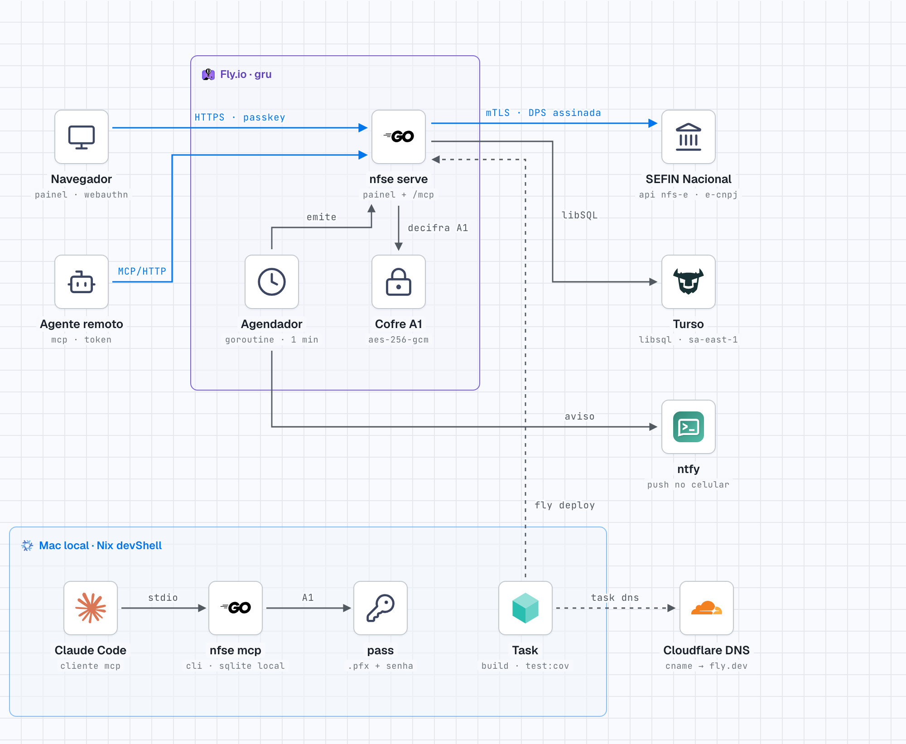
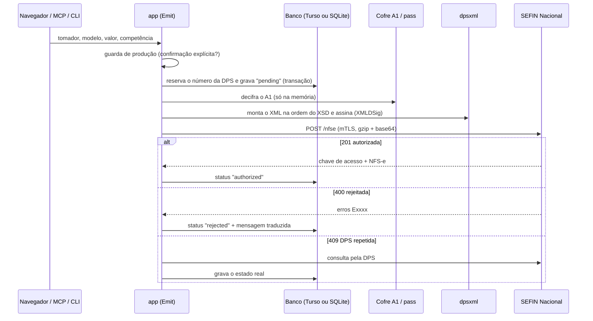

# nfse-digital — emissor pessoal de NFS-e

Emissor de **Nota Fiscal de Serviço eletrônica (NFS-e)** no padrão nacional, falando direto com a API da **SEFIN Nacional** — sem portal do governo e sem SaaS no meio. Um único binário Go (`nfse`) oferece três portas de entrada sobre o mesmo núcleo: **painel web**, **servidor MCP** (pedir a nota a um agente de IA) e **CLI**.

Em produção: **<https://nfse.bassi.engineer>** — uma máquina no Fly.io (região `gru`) com banco no Turso.



> Versão escura: [`docs/diagram/nfse-stack-dark.png`](docs/diagram/nfse-stack-dark.png) · versão interativa (HTML autocontido, abre offline): [`docs/diagram/nfse-stack.html`](docs/diagram/nfse-stack.html) · regerar: `task diagram`.

## Recursos

- **Emissão de NFS-e no padrão nacional** direto na SEFIN (homologação e produção), com o certificado A1 da empresa; erro da SEFIN traduzido para português.
- **Painel web** com notas, tomadores, modelos de serviço, DANFSe em PDF, cancelamento e sincronização com a SEFIN.
- **Importação do que já foi emitido**: pelo Portal Nacional (com o certificado) ou por XML.
- **Agendamentos**: nota mensal recorrente às 03:00, com aviso na véspera (ntfy) e novas tentativas se a SEFIN estiver fora.
- **Envio da nota por e-mail** pelo seu Gmail (senha de app), automático ou manual, com o DANFSe e o XML anexados.
- **Agente de IA (MCP)**: emitir, consultar e cancelar conversando com Claude Code, Claude Desktop ou Codex.
- **API REST** com idempotência, contrato OpenAPI 3.1, documentação navegável (Scalar), `llms.txt` e **SDKs em Go, Python e TypeScript**.
- **Várias contas** no mesmo painel, cada uma com o próprio emitente, certificado e dados.
- **Guarda de produção**: nenhuma nota com valor fiscal sai sem confirmação explícita, em nenhum canal.

## Início rápido

Pré-requisitos: [Nix](https://nixos.org/download/) (traz Go, Task e Tailwind) **ou** Go 1.26 + [Task](https://taskfile.dev/) + [Tailwind CSS v4 standalone](https://tailwindcss.com/blog/standalone-cli) no `PATH`. Para emitir de verdade: o **certificado A1** (`.pfx`) da empresa.

```bash
git clone https://github.com/andrebassi/nfse-digital.git
cd nfse-digital
mkdir -p ~/.config/nfse-digital                     # chave do cofre: gere UMA vez e guarde
[ -f ~/.config/nfse-digital/cert.key ] || (umask 077; openssl rand -base64 32 > ~/.config/nfse-digital/cert.key)
export NFSE_CERT_KEY="$(cat ~/.config/nfse-digital/cert.key)"
task build          # gera o CSS e compila bin/nfse
task serve          # painel em http://127.0.0.1:8735 (banco SQLite em ~/.local/share/nfse-digital)
```

Depois, no navegador:

1. **Crie a conta** e envie o **certificado A1** em Configurações → Certificado.
2. Preencha o **emitente** em Configurações → Emitente (a conta começa em **homologação**: nada tem valor fiscal).
3. Cadastre **tomadores** e **modelos de serviço** — ou importe do Portal Nacional.
4. **Emita a primeira nota** de teste. Passe para produção só quando estiver tudo certo.

O passo a passo de cada tela está no **[manual de uso](docs/user-manual.md)**. Instalação detalhada, as duas formas de guardar o certificado e o deploy num servidor estão nas seções [8](#8-configuração), [9](#9-instalação-e-desenvolvimento-local) e [11](#11-deploy).

---

## Sumário

- [Recursos](#recursos) · [Início rápido](#início-rápido) · [Manual de uso](docs/user-manual.md) · [Site de documentação](https://nfse-docs.bassi.engineer)

1. [O problema que ele resolve](#1-o-problema-que-ele-resolve)
2. [Glossário rápido](#2-glossário-rápido)
3. [Arquitetura, lendo o diagrama](#3-arquitetura-lendo-o-diagrama)
4. [O caminho de uma nota, de ponta a ponta](#4-o-caminho-de-uma-nota-de-ponta-a-ponta)
5. [Organização do código (hexagonal)](#5-organização-do-código-hexagonal)
6. [Segurança](#6-segurança)
7. [Como usar](#7-como-usar) — painel, MCP, [API REST e llms.txt](#73-api-rest-integração-de-sistemas), CLI
8. [Configuração](#8-configuração)
9. [Instalação e desenvolvimento local](#9-instalação-e-desenvolvimento-local)
10. [Testes e gate de cobertura](#10-testes-e-gate-de-cobertura)
11. [Deploy](#11-deploy)
12. [Armadilhas conhecidas](#12-armadilhas-conhecidas)
13. [Documentação relacionada](#13-documentação-relacionada)

---

## 1. O problema que ele resolve

Emitir uma NFS-e pela API nacional exige três coisas que nenhuma ferramenta pequena junta bem:

| Exigência | Como o nfse resolve |
|---|---|
| Assinar o XML da DPS com o **certificado A1** (e-CNPJ) e usar o mesmo certificado no **TLS mútuo** | O A1 vive no `pass` (máquina local) ou selado com AES-256-GCM no banco (Fly); só existe decifrado na memória, na hora de assinar |
| Montar o XML **na ordem exata do XSD** oficial, senão a SEFIN rejeita | Adapter `dpsxml` gera e assina; teste valida contra os XSD versionados em `schemas/` (`task xsd:check`) |
| Não emitir **duas vezes** a mesma nota (rede cai, processo reinicia) | O número da DPS é reservado e gravado como `pending` **antes** do envio; reenvio usa o mesmo número; o agendador tem índice único `(agendamento, mês)` no banco |

O resto — cadastro de tomadores, modelos de serviço, notas recorrentes, DANFSe em PDF, cancelamento — é o que torna o uso mensal confortável.

## 2. Glossário rápido

| Termo | O que é |
|---|---|
| **NFS-e** | A nota fiscal de serviço, já autorizada, devolvida pela SEFIN com **chave de acesso** de 50 dígitos |
| **DPS** | *Declaração de Prestação de Serviço*: o XML que o emissor monta e assina. A SEFIN recebe a DPS e devolve a NFS-e |
| **SEFIN Nacional** | API do Sistema Nacional NFS-e que registra a DPS e eventos (cancelamento) |
| **ADN** | *Ambiente de Dados Nacional*: de onde se leem notas e eventos já registrados (sincronização, importação) |
| **A1** | Certificado digital ICP-Brasil em arquivo `.pfx` (PKCS#12) com senha; assina o XML e autentica o TLS |
| **mTLS** | TLS mútuo: o cliente também apresenta certificado. É como a SEFIN sabe quem está emitindo |
| **Homologação / produção** | *Produção restrita* (testes, sem valor fiscal) e produção de verdade. O padrão é homologação |
| **DANFSe** | O PDF da nota, com QR Code para consulta pública. Gerado localmente: a API de geração do ADN foi suspensa em 03/08/2026 (NT-008) |
| **Competência** | O mês a que o serviço se refere (não necessariamente o mês da emissão) |

## 3. Arquitetura, lendo o diagrama

O diagrama tem três tipos de linha: **azul** é o fluxo de emissão (o pedido do usuário até a SEFIN), **cinza sólida** é ligação interna e **tracejada** é desenvolvimento/deploy.

### 3.1 Produção — caixa roxa “Fly.io · gru”

| Peça | Papel |
|---|---|
| **nfse serve** | O mesmo binário Go, rodando o painel HTTP e o endpoint MCP `/mcp`. Imagem `distroless/static` (traz CA e tzdata, necessários ao TLS com a SEFIN e ao fuso de São Paulo), compilada com `CGO_ENABLED=0` |
| **Agendador** | Goroutine ligada por `--run-schedules`; roda **a cada minuto** e emite as notas recorrentes vencidas |
| **Cofre A1** | Adapter `vaultcert`: o `.pfx` e a senha de cada conta são selados **juntos** num blob AES-256-GCM gravado no banco. A chave mestra (`NFSE_CERT_KEY`, 32 bytes) fica só no secret do Fly e no `pass` |

A máquina é `shared-cpu-1x` com 256 MB, **sem volume**, e com `auto_stop_machines = "suspend"`: dorme sem tráfego e acorda em menos de 1 s.

### 3.2 Serviços externos — coluna da direita

| Serviço | Para quê | Protocolo |
|---|---|---|
| **SEFIN Nacional** | Registrar DPS (`POST /nfse`), consultar, registrar evento de cancelamento | HTTPS com mTLS (A1), corpo `{"dpsXmlGZipB64": …}` — XML assinado, gzip, base64 |
| **Turso** | Banco (libSQL remoto, `aws-sa-east-1`, mesma cidade do Fly) | Hrana sobre HTTP, driver `tursogo-serverless` em Go puro |
| **ntfy** | Aviso do agendador no celular (nota emitida, falha, véspera) | HTTP `POST` no tópico configurado em `NFSE_NTFY_URL`, prazo de 10 s |

### 3.3 Quem chama — coluna da esquerda

- **Navegador**: painel web, login por senha ou **passkey** (WebAuthn).
- **Agente remoto**: qualquer cliente MCP que fale HTTP, autenticado por **token** gerado no painel (tela *Integrações*).

### 3.4 Máquina local — caixa azul “Mac local · Nix devShell”

- **Claude Code → `nfse mcp`**: o mesmo binário como servidor MCP via **stdio** (configurado em [`.mcp.json`](.mcp.json)), com banco SQLite local.
- **`nfse mcp` → `pass`**: localmente o A1 sai do `pass` (`bassi/nfse/cert-a1-pfx` e `bassi/nfse/cert-a1-password`), nunca de arquivo.
- **Task**: build, testes, `task deploy` (Fly) e `task dns` (CNAME no Cloudflare).
- **Cloudflare DNS**: `nfse.bassi.engineer` → `nfse-digital.fly.dev`, **sem proxy** — o certificado TLS do domínio é emitido pelo Fly.

### 3.5 Por que esse desenho

| Decisão | Motivo | Alternativa descartada |
|---|---|---|
| Turso em vez de volume no Fly | Máquina sem volume pode dormir, ser recriada e mudar de host sem perder dado | Volume Fly: amarra a máquina a um host e exige backup próprio |
| `tursogo-serverless` | Go puro, mantém `CGO_ENABLED=0` e a imagem distroless estática | `go-libsql` (embedded replica): exige CGO e arquivo local |
| Cofre no banco | O Fly não tem `pass`; o A1 precisa chegar ao servidor sem ficar em claro | Secret com o `.pfx`: um por conta, não escala para mais de um emitente |
| Máquina que dorme | Uso pessoal: poucas notas por mês, custo perto de zero | `min_machines_running = 1`: paga 24 h para trabalhar minutos |
| DANFSe local | A API de geração do ADN foi suspensa; o emissor passou a ser responsável | — |

## 4. O caminho de uma nota, de ponta a ponta

Exemplo: emitir pelo painel.



Passo a passo, com o porquê:

1. **Guarda de produção** (`internal/app/guard.go`) — em homologação passa sempre; em produção exige confirmação do canal: `--production` na CLI, `confirm_production` no MCP e no painel, ou a permissão gravada no agendamento. Vem **antes** de reservar número ou abrir o certificado.
2. **Reserva do número** — o número sai de `next_number` e a nota é gravada como `pending` na mesma transação. Se a rede cair depois, o reenvio usa **o mesmo número**: a SEFIN responde 409 em vez de criar uma segunda nota.
3. **Certificado** — decifrado só na memória do processo; nenhum caminho grava o `.pfx` em disco.
4. **XML e assinatura** — `dpsxml` monta a DPS (leiaute 1.01) na ordem do XSD e assina com RSA-SHA1 sobre C14N 1.0 inclusivo, os mesmos algoritmos que a SEFIN usa na nota real.
5. **Envio** — `POST /nfse` com mTLS e prazo de 60 s. Todo envio guarda o XML enviado e a resposta recebida, com sucesso ou erro.
6. **Resultado** — autorizada, rejeitada (com o código `Exxxx` traduzido) ou, em caso de dúvida, consultada pela DPS.

**Nota recorrente (agendador):** a cada minuto ele procura agendamentos vencidos. A garantia de “uma nota por mês” não depende da memória do processo, e sim do índice único `(agendamento, mês)` no banco. Nota que fica pendente por falha de comunicação é retentada **uma vez por hora**.

**Sincronização (`nfse sync` / botão no painel):** só **lê** da SEFIN/ADN. Pendente sem chave procura a chave pela DPS; autorizada procura cancelamento feito fora daqui. Nunca reenvia nada: reenviar é decisão do dono, depois de saber o estado.

## 5. Organização do código (hexagonal)

```
nfse-digital/
├── cmd/nfse/                 # wiring e subcomandos da CLI (fora do gate de cobertura)
├── internal/
│   ├── domain/               # DPS, Customer, Template, Invoice, Schedule, dinheiro em centavos — só stdlib
│   ├── ports/                # interfaces: repositório, certificado, emissor, relógio
│   ├── app/                  # casos de uso: emitir, cancelar, sincronizar, importar, agendar, autenticar
│   └── adapters/
│       ├── web/              # painel (net/http + html/template + Tailwind), passkey, /mcp por HTTP
│       ├── mcpserver/        # servidor MCP (go-sdk oficial): catálogo de ferramentas e skill do agente
│       ├── sefin/            # cliente mTLS da SEFIN e do ADN
│       ├── dpsxml/           # XML da DPS e do evento de cancelamento + XMLDSig
│       ├── nfsexml/          # leitura de XML de NFS-e (importar nota anterior como modelo)
│       ├── danfse/           # PDF do DANFSe com QR Code
│       ├── sqlite/           # schema, migrações e consultas (modernc.org/sqlite, Go puro)
│       ├── turso/            # abre o mesmo adapter sqlite sobre o Turso remoto
│       ├── passcert/         # A1 vindo do pass
│       ├── vaultcert/        # A1 selado no banco (AES-256-GCM)
│       ├── ntfy/             # aviso no celular
│       ├── memory/           # repositório em memória (testes e protótipo)
│       ├── simulated/        # emissor falso para testes ponta a ponta
│       └── textsearch/       # busca sem acento e sem maiúscula ("ipe" acha "IPÊ")
├── schemas/                  # XSD oficiais versionados (v1.01 e produção restrita)
├── testdata/                 # DPS e NFS-e de referência
├── docs/                     # PRD, arquitetura, stories, notas da SEFIN, diagrama
└── scripts/                  # tudo que o Taskfile executa
```

Regra de dependência: `domain` não importa nada fora da stdlib; `app` depende de `ports`; `adapters` implementam `ports`. Por isso o mesmo núcleo atende painel, MCP e CLI, e o banco troca entre SQLite e Turso só pela URL (`NFSE_DB`).

**Valor monetário é sempre `int64` em centavos**, nunca `float64`.

## 6. Segurança

| Camada | Mecanismo |
|---|---|
| Certificado A1 | `pass` (local) ou blob AES-256-GCM com `.pfx` + senha selados juntos (Fly); decifrado só na memória; mensagens de erro nunca carregam senha nem bytes do certificado |
| Chave do cofre | `NFSE_CERT_KEY` só em secret do Fly e em `pass bassi/nfse/cert-vault-key`. **Perder a chave = certificados selados ilegíveis** (cada conta reenvia o `.pfx`) |
| Login | Senha ou passkey (WebAuthn); sessão de 1 dia em memória (reiniciar desloga) |
| Cadastro | Painel público **exige** `NFSE_SIGNUP_EMAILS`: o processo recusa subir com `NFSE_PUBLIC_HOST` sem a lista |
| Formulários | Token CSRF aleatório por processo em todo POST |
| Host | Pedido com `Host` diferente do configurado recebe **403** — por isso `nfse-digital.fly.dev` responde 403 e o health check do Fly manda `Host: nfse.bassi.engineer` |
| Tokens MCP | Prefixo `nf_`, 256 bits, banco guarda só o SHA-256; revogáveis no painel; erro não diz se o token não existe ou foi revogado |
| Produção | Guarda única para emitir, reenviar, cancelar e agendar (seção 4) |
| Corpo MCP | Tamanho limitado, para um token vazado não encher a memória do painel |
| API REST | Mesmo token do MCP, preso à conta; mesmo filtro de `Host`; corpo limitado a 64 KB; campo desconhecido recusado (400); erro sempre em JSON, sem detalhe interno |
| Senha de app do Gmail | Testada com login antes de gravar; selada com AES-256-GCM (dado autenticado = conta + propósito); nunca volta para a tela; o cliente SMTP só manda a senha sobre TLS |
| E-mail | Quebra de linha no assunto ou no nome do remetente é recusada (injeção de cabeçalho); destinatários só como endereço puro |
| Documentação da API | Scalar vendorizado no binário (sem CDN); CSP da página só aceita script do próprio host; telemetria, "Ask AI" e barra de desenvolvedor desligados |

## 7. Como usar

### 7.1 Painel web

Acesse <https://nfse.bassi.engineer> (ou `task serve` → <http://127.0.0.1:8735>). Telas principais:

| Tela | Rota | O que faz |
|---|---|---|
| Notas | `/invoices` | lista, filtros, KPIs, DANFSe (`/invoices/{id}/danfse`) e **Cancelar nota** no detalhe da nota autorizada (motivo, justificativa de 15 a 255 caracteres e, em produção, caixa de confirmação) |
| Emitir | `/emit` | formulário de emissão |
| Tomadores / Modelos | `/customers`, `/templates` | cadastros; `/templates/import` cria modelo a partir do XML de uma nota antiga |
| Portal | `/portal` | varre o ADN e sugere modelos a partir das notas já emitidas |
| Agendamentos | `/schedules` | notas mensais recorrentes |
| Configurações | `/settings` | emitente (com **alíquota aproximada do Simples**, obrigatória para ME/EPP), certificado, passkeys, ambiente (homologação/produção, produção pede o CNPJ), excluir conta |
| Integrações | `/integrations` | tokens de API (MCP e REST), instruções de conexão por agente, aba **API REST** (`/integrations/api`) com URL base, exemplos prontos e links para a documentação, catálogo de ferramentas, `skill.md` |

### 7.2 MCP (agente de IA)

Ferramentas expostas (mesmo catálogo no stdio e no HTTP):

| Ferramenta | Escreve? | Função |
|---|---|---|
| `account_status` | não | emitente, ambiente, numeração, validade do certificado, pendências de configuração |
| `list_customers` · `list_templates` · `list_invoices` · `list_schedules` | não | consultas |
| `show_invoice` | não | nota com status, chave e erro da SEFIN traduzido |
| `download_danfse` | não | gera o PDF e devolve o caminho |
| `emit_invoice` | **sim** | emite; aceita `idempotency_key` (repetir devolve a mesma nota) |
| `cancel_invoice` | **sim** | cancela na SEFIN — irreversível |

Local (stdio): o [`.mcp.json`](.mcp.json) da raiz já aponta para `bin/nfse mcp`. Remoto: gere um token em *Integrações* e use `https://nfse.bassi.engineer/mcp`. `nfse skill` imprime a skill do agente.

### 7.3 API REST (integração de sistemas)

Para o ERP ou o sistema de faturamento **emitir, listar, consultar e cancelar** notas sem agente no meio. Mesma regra de negócio do painel e do MCP; mesmo token (gerado em *Integrações → API REST* ou *Tokens de API*, cabeçalho `Authorization: Bearer nf_…`). Tomadores e modelos continuam sendo cadastrados no painel — a API só os lista.

| Método | Rota (`/api/v1`) | Status | O que faz |
|---|---|---|---|
| GET | `/account` | 200, 401, 404 | emitente, ambiente, próximo número da DPS |
| GET | `/customers?q=` · `/templates?q=` | 200, 401 | cadastros, só leitura |
| GET | `/invoices?status=&limit=` | 200, 400, 401 | notas, mais recente primeiro (limite 1–100, padrão 20) |
| POST | `/invoices` | 200, 201, 202, 400, 401, 409, 422 | emite; `idempotency_key` obrigatória — repetir a chave devolve a mesma nota (200), nunca emite outra |
| GET | `/invoices/{id}` · `/invoices/by-key?idempotency_key=` | 200, 401, 404 | consulta pelo id ou pela chave do integrador |
| POST | `/invoices/{id}/cancel` | 200, 400, 401, 404, 409, 422, 502, 503 | cancela na SEFIN — irreversível |
| GET | `/invoices/{id}/danfse` | 200, 401, 404, 409, 503 | PDF do DANFSe |

- **Produção** exige `"confirm_production": true` no corpo (sem isso, 409 e nada sai para a SEFIN) — a mesma guarda da story 4.1.
- **Campo desconhecido no JSON é 400**: um `confirmProduction` digitado errado não passa calado.
- **202** = SEFIN sem resposta definitiva; consultar por `by-key` antes de tentar de novo, e só com a mesma chave.
- A API só existe com o MCP por HTTP ligado (é quando o painel emite token) — o que vale para `nfse serve`.

Três rotas públicas, sem token:

| Rota | O quê |
|---|---|
| `/api/docs` | referência navegável renderizada pelo [Scalar](https://github.com/scalar/scalar) 1.76.4 (MIT), **vendorizado** em `static/vendor/` — sem CDN, CSP só com script do próprio host, barra de desenvolvedor, "Ask AI" e telemetria desligados (os três mandariam o contrato para a nuvem do Scalar). Exemplos em curl, Node.js, Python e outros saem do contrato |
| `/api/v1/openapi.json` | contrato OpenAPI 3.1 escrito à mão ([`internal/adapters/web/api/openapi.json`](internal/adapters/web/api/openapi.json)); `servers` sai com o endereço do painel que serve o arquivo. Um teste confere rota × contrato nos dois sentidos |
| `/api/llms.txt` | guia para agente, ver abaixo |

#### SDKs (Go, Python, TypeScript)

Clientes gerados do mesmo `openapi.json` por geradores abertos com versão fixa: **Go** (oapi-codegen), **Python** (openapi-python-client) e **TypeScript** (@hey-api/openapi-ts). Instalação, exemplos e limites de cada um: **[`sdk/README.md`](sdk/README.md)**.

```bash
go get github.com/andrebassi/nfse-digital/sdk/go@main
pip install "nfse-digital @ git+https://github.com/andrebassi/nfse-digital.git#subdirectory=sdk/python"
```

`task sdk:check` reprova se o SDK versionado divergir do contrato; `task sdk:smoke` roda o mesmo roteiro nos três contra o binário real (18 checagens).

#### llms.txt da API

[`/api/llms.txt`](https://nfse.bassi.engineer/api/llms.txt) segue a convenção [llms.txt](https://llmstxt.org/): um arquivo texto que um modelo lê para integrar um sistema a esta API **sem ler mais nada**.

| | Documentação (`/api/docs`) | `llms.txt` |
|---|---|---|
| Leitor | pessoa | agente (Claude, Cursor, Codex) |
| Estilo | navegável, uma operação por página | um arquivo só, tabelado |
| Endereços | relativos ao servidor escolhido | absolutos, preenchidos com o host que serviu o arquivo |
| Além do contrato | — | ordem certa das chamadas, o que fazer em cada status, as regras que o agente não pode quebrar (chave estável, consultar antes de reenviar, confirmar produção com uma pessoa) |

Como usar:

- **Colar num chat**: `curl -s https://nfse.bassi.engineer/api/llms.txt | pbcopy` e colar no começo da conversa.
- **Ferramenta autônoma**: apontar o agente para a URL `https://nfse.bassi.engineer/api/llms.txt` (ou `http://127.0.0.1:8735/api/llms.txt` no painel local).
- **Manter atualizado**: a fonte é [`internal/adapters/web/api/llms.txt`](internal/adapters/web/api/llms.txt) (template Go, `{{.BaseURL}}` vira o host). Mudou rota ou status em `api.go`? Atualizar o `openapi.json` (o teste reprova se divergir) e esta tabela à mão — o `llms.txt` não tem teste de conteúdo além de "sai com URL absoluta".

Verificação ponta a ponta no binário real: `task api:smoke` (banco temporário, porta 8798, conta descartável, token gerado pela tela, 23 checagens, sem falar com a SEFIN).

### 7.4 Envio da nota por e-mail

**Tomadores → (tomador) → Envio por e-mail** (`/customers/{id}/email`).

| Campo | Regra |
|---|---|
| Gmail que envia + senha de app | um remetente por conta (vale para todos os tomadores). A senha de app (16 letras, [myaccount.google.com/apppasswords](https://myaccount.google.com/apppasswords)) é **testada com um login no Gmail ao salvar** — senha errada nunca é gravada — e guardada selada com AES-256-GCM (dado autenticado = conta + propósito; o blob de uma conta não abre na outra). Nunca volta para a tela |
| Para · Cópia | listas separadas por vírgula; só endereço puro (sem "Nome <…>", que entraria no cabeçalho) |
| Assunto · Mensagem | marcadores `{numero}` `{valor}` `{competencia}` `{mesCompetencia}` `{dataEmissao}` `{tomador}` `{emitente}` `{cnpjEmitente}` `{descricao}` `{chave}` `{linkConsulta}` |
| Anexos | DANFSe (PDF) e XML da NFS-e; o XML que faltar é buscado na SEFIN pela chave |
| Enviar automaticamente | cada nota **autorizada** do tomador sai sozinha logo depois de gravada — pelo painel, pela API, pelo MCP e pelo agendador. Falha do Gmail **não desfaz a emissão**: fica no histórico da nota |

- **Prévia** ao vivo com a nota de exemplo nº 123 (R$ 1.500,00): o `email.js` pede o cartão ao servidor, que resolve os marcadores pela mesma regra do envio real.
- **Enviar teste**: usa o texto da tela sem salvar, assunto com `[TESTE]`, sem cópia, anexos de exemplo com a marca **"SIMULAÇÃO · SEM VALOR FISCAL"** (no PDF, em diagonal; no XML, na primeira linha). Nada é gravado.
- **Agendamento**: a caixa "Enviar a nota ao tomador após a emissão" manda a nota agendada mesmo sem o envio automático do tomador; com ele ligado, sai um e-mail só.
- **Detalhe da nota autorizada**: botão **Enviar por e-mail** e o histórico ("Enviada/Falhou · automático/manual · destinatários").
- **Verificação ponta a ponta sem Gmail**: `task email:smoke` sobe o [Mailpit](https://mailpit.axllent.org/) por Nix, aponta o painel para ele (`NFSE_SMTP_ADDR`) e confere 19 pontos pela API do Mailpit — inclusive o envio de uma NFS-e real de `testdata/` com DANFSe e XML. `KEEP=1` deixa a caixa em `http://127.0.0.1:8026`.

#### Como o e-mail sai

O envio usa **o próprio Gmail da conta**, sem serviço de terceiro (nada de SendGrid, SES ou Mailgun):

1. o painel conecta em `smtp.gmail.com:587` (pacote [`internal/adapters/smtpmail`](internal/adapters/smtpmail));
2. sobe o TLS com `STARTTLS` (TLS 1.2 ou maior) **antes** do login — a senha nunca trafega em claro;
3. faz login (`AUTH PLAIN`) com o endereço e a senha de app;
4. entrega a mensagem MIME: texto em UTF-8 e os anexos em base64. Prazo de 30 s para a conversa inteira: um servidor mudo não prende a emissão.

| Consequência | Detalhe |
|---|---|
| Entregabilidade | o e-mail sai assinado pelo Google (`@gmail.com`), então raramente cai em spam |
| Cópia em Enviados | o Gmail guarda em **Enviados** o que sai por SMTP: cada nota enviada fica lá |
| Custo | zero; vale o limite diário de envio do Gmail pessoal (da ordem de centenas de destinatários por dia) |
| Revogar | apagar a senha de app em [myaccount.google.com/apppasswords](https://myaccount.google.com/apppasswords) corta o envio na hora; a senha normal do Google nunca é usada nem guardada |
| Onde a senha fica | tabela `email_senders`, selada pela chave do servidor (`NFSE_CERT_KEY`, ou `~/.local/share/nfse-digital/secret.key` no painel local sem ela) |
| Outro provedor | `NFSE_SMTP_ADDR` troca o servidor (porta 587 com STARTTLS e login): um domínio próprio entra sem mudar o resto |

### 7.5 CLI

```bash
nfse version
nfse cert check                       # titular, CNPJ, AC e validade do A1 (aviso a < 30 dias)
nfse emit …                           # emitir (produção exige --production)
nfse list | nfse show <id>
nfse import <arquivo.xml>             # nota antiga vira tomador + modelo
nfse fetch | nfse sync                # ler do ADN / alinhar estado local com a SEFIN
nfse danfse <id>                      # PDF
nfse cancel <id>
nfse schedule add|list|pause|resume|remove|run
nfse settings
nfse serve [--port 8735] [--db <arquivo>] [--run-schedules]
nfse mcp                              # servidor MCP via stdio
nfse skill                            # imprime a skill do agente
```

## 8. Configuração

| Variável | Onde | Função |
|---|---|---|
| `NFSE_DB` | `fly.toml` / local | URL `libsql://…` (Turso) ou caminho de arquivo SQLite. Padrão local: `~/.local/share/nfse-digital/nfse.db` |
| `TURSO_AUTH_TOKEN` | secret Fly · `pass bassi/turso/nfse-auth-token` | token do Turso |
| `NFSE_CERT_KEY` | secret Fly · `pass bassi/nfse/cert-vault-key` | chave AES-256 do cofre (32 bytes, base64); sela também a senha de app do Gmail. Sem ela (painel local), a senha é selada com `~/.local/share/nfse-digital/secret.key`, gerado na 1ª subida com permissão 600 — perder o arquivo só obriga a informar a senha de app de novo |
| `NFSE_CORS_ORIGINS` | `fly.toml` | origens (separadas por vírgula) que podem chamar `/api/v1` do navegador: o playground e o "Test Request" da documentação. Só a origem exata recebe `Access-Control-Allow-Origin`; o resto tem a pré-checagem recusada (403). Seguro porque a API se autentica por token, nunca por cookie |
| `NFSE_SMTP_ADDR` | ambiente | servidor SMTP do envio por e-mail; padrão `smtp.gmail.com:587`. Só para teste local (Mailpit no `task email:smoke`) |
| `NFSE_SIGNUP_EMAILS` | secret Fly | quem pode criar conta (obrigatória com host público) |
| `NFSE_PUBLIC_HOST` | `fly.toml` | domínio público; liga cookies `Secure` e o filtro de `Host` |
| `NFSE_LISTEN` | `fly.toml` | endereço de escuta (`0.0.0.0:8080` no Fly; local fica em `127.0.0.1`) |
| `NFSE_NTFY_URL` | ambiente | tópico do ntfy para os avisos do agendador |
| `NFSE_PASS_PREFIX` | ambiente | prefixo do A1 no `pass` (padrão `bassi/nfse`) |
| `NFSE_ACCOUNT` | ambiente | conta usada pela CLI/MCP quando há mais de uma |

Exemplo para desenvolvimento: [`config/dev-account.example.env`](config/dev-account.example.env).

**Endpoints da SEFIN** (`internal/adapters/sefin`):

| Ambiente | SEFIN | ADN |
|---|---|---|
| Homologação (produção restrita) | `https://sefin.producaorestrita.nfse.gov.br/SefinNacional` | `https://adn.producaorestrita.nfse.gov.br` |
| Produção | `https://sefin.nfse.gov.br/SefinNacional` | `https://adn.nfse.gov.br` |

Sem certificado cliente, essas URLs respondem **403** (medido em 01/11/2026) — é o mTLS recusando, não serviço fora do ar.

## 9. Instalação e desenvolvimento local

### Pré-requisitos

| Ferramenta | Para quê | Como ter |
|---|---|---|
| Go 1.26 | compilar o binário | o [`flake.nix`](flake.nix) traz, ou [go.dev/dl](https://go.dev/dl/) |
| Task | as tasks do [`Taskfile.yaml`](Taskfile.yaml) | flake, ou [taskfile.dev](https://taskfile.dev/installation/) |
| Tailwind CSS v4 standalone | o CSS do painel (sem Node) | `task css` chama por `nix shell`; sem Nix, o binário `tailwindcss` no `PATH` |
| openssl, libxml2 | conferir o `.pfx`; validar a DPS no XSD | flake |
| [`pass`](https://www.passwordstore.org/) | opcional: guardar o certificado fora do banco | só no modo "certificado no pass" |

Com Nix: `nix develop` abre um shell com tudo. Docker não é usado no desenvolvimento — só a imagem do deploy.

### Onde o certificado A1 fica: dois modos

| Modo | Liga com | Como o certificado entra | Bom para |
|---|---|---|---|
| **Cofre no banco** (recomendado) | `NFSE_CERT_KEY` definida (32 bytes em base64: `openssl rand -base64 32`) | pelo painel, em Configurações → Certificado; `.pfx` e senha selados juntos com AES-256-GCM | servidor, várias contas, quem não usa `pass` |
| **pass** | `NFSE_CERT_KEY` vazia | `task cert:import -- "<arquivo>.pfx"` grava em `pass` (prefixo `NFSE_PASS_PREFIX`, padrão `bassi/nfse`) | uma conta só, na máquina do dono |

⚠️ **Guarde a `NFSE_CERT_KEY`** num cofre: perdê-la deixa os certificados selados ilegíveis (cada conta reenvia o `.pfx`) e obriga a informar de novo a senha de app do Gmail.

### Rodar

```bash
task build                  # gera o CSS e compila bin/nfse
task serve                  # painel em http://127.0.0.1:8735 (SQLite local, SEFIN real)
task cert:check             # (modo pass) confere titular e validade do A1
```

O painel local escuta só em `127.0.0.1`. Banco: `~/.local/share/nfse-digital/nfse.db` (ou `--db`/`NFSE_DB`; uma URL `libsql://` usa o Turso). Passkeys exigem abrir por `http://localhost:8735` (o WebAuthn não aceita IP).

| Task | O que faz |
|---|---|
| `css` | gera `static/app.css` com o Tailwind standalone (sem Node) |
| `build` | `bin/nfse` |
| `test` | todos os testes |
| `test:cov` | gate de cobertura (seção 10) |
| `test:turso` | exclusão de conta contra o Turso **real**, com conta descartável |
| `e2e` | ponta a ponta no SQLite: cria conta e emitente, emite, reinicia e confere que nada se perdeu |
| `xsd:check` | valida a DPS de referência no XSD oficial com `xmllint` |
| `smoke:homologation` | emite R$ 1,00 na homologação com o A1 real (`NFSE_SMOKE_TAKER=<CNPJ do tomador>`) |
| `serve` | sobe o painel local |
| `deploy` | publica no Fly (seção 11) |
| `api:smoke` | API REST no binário real: banco temporário, token gerado pela tela, 23 checagens (sem SEFIN) |
| `sdk:generate` · `sdk:check` · `sdk:smoke` | regera os SDKs Go/Python/TypeScript do `openapi.json` · reprova SDK fora do contrato · roda os três contra o binário real |
| `email:smoke` | envio por e-mail no binário real contra o Mailpit: 19 checagens, sem Gmail (`KEEP=1` deixa no ar) |
| `dns` | CNAME no Cloudflare |
| `cancel` | cancela pela CLI uma nota do painel publicado (`task cancel -- <id> --production`) |
| `nfse:xml` | baixa da SEFIN o XML de uma NFS-e pela chave (`task nfse:xml -- <chave> [--production]`) |
| `diagram` | regenera `docs/diagram` (HTML + PNG claro e escuro) |

## 10. Testes e gate de cobertura

[`scripts/coverage-gate.sh`](scripts/coverage-gate.sh) mede cobertura **por pacote** e **reprova** (rc=1) abaixo do piso — `go test -cover` sozinho só imprime e sai 0. Pisos: `internal/domain` **100%**, demais pacotes de `internal/` **90%**. Isentos: `cmd/` (wiring) e `internal/ports` (só interfaces). Prova de falha: `COVERAGE_FLOOR=101 task test:cov` tem que reprovar.

Medido em 02/11/2026 (`task test:cov`, rc=0 — 74 arquivos de teste, 262 funções `Test*`):

| Pacote | Cobertura | Piso |
|---|---:|---:|
| `domain` | 100,0% | 100% |
| `app` | 95,9% | 90% |
| `adapters/danfse` | 97,8% | 90% |
| `adapters/dpsxml` | 96,2% | 90% |
| `adapters/maildocs` | 96,9% | 90% |
| `adapters/mcpserver` | 94,1% | 90% |
| `adapters/memory` | 96,1% | 90% |
| `adapters/nfsexml` | 96,0% | 90% |
| `adapters/ntfy` | 100,0% | 90% |
| `adapters/passcert` | 97,3% | 90% |
| `adapters/secretbox` | 96,2% | 90% |
| `adapters/sefin` | 98,2% | 90% |
| `adapters/simulated` | 100,0% | 90% |
| `adapters/smtpmail` | 95,9% | 90% |
| `adapters/sqlite` | 93,5% | 90% |
| `adapters/textsearch` | 100,0% | 90% |
| `adapters/turso` | 92,9% | 90% |
| `adapters/vaultcert` | 90,9% | 90% |
| `adapters/web` | 93,9% | 90% |

Limite declarado: Go não mede branch nativamente; o número é de linha (statements). As decisões são cobertas por testes de tabela que exercitam os dois lados. A SEFIN é simulada nos testes por um servidor TLS falso (`httptest`).

## 11. Deploy

### Publicar a sua própria instância (Fly.io + Turso)

1. Crie um banco no [Turso](https://turso.tech/) e gere um token (`turso db create`, `turso db tokens create`).
2. No [`fly.toml`](fly.toml), troque `app`, `NFSE_DB` (a URL `libsql://` do seu banco), `NFSE_PUBLIC_HOST` e o `Host` do health check pelo seu domínio.
3. Defina os secrets: `fly secrets set TURSO_AUTH_TOKEN=… NFSE_CERT_KEY=… NFSE_SIGNUP_EMAILS=voce@exemplo.com`.
4. `fly deploy --remote-only` e aponte o domínio (CNAME para `<app>.fly.dev`; `fly certs add <domínio>`).

O painel público **recusa subir** sem `NFSE_SIGNUP_EMAILS` — sem a lista, qualquer pessoa criaria conta. A máquina dorme sem tráfego (`auto_stop_machines = "suspend"`): o agendador só roda acordado, e a emissão vencida sai na primeira rodada depois que alguém abrir o painel (vale até o fim do mês).

### O deploy do dono

O [`scripts/fly-deploy.sh`](scripts/fly-deploy.sh) automatiza os passos acima lendo os segredos do `pass` (caminhos `bassi/...`; adapte para os seus). App e domínio vêm de `NFSE_FLY_APP` e `NFSE_PUBLIC_HOST`, com os do dono como padrão.

```bash
task deploy     # scripts/fly-deploy.sh, log em /tmp/nfse-fly-deploy.log
task dns        # uma vez: CNAME nfse.bassi.engineer → nfse-digital.fly.dev
```

O script é idempotente e roda seis etapas:

1. cria o app `nfse-digital` se não existir;
2. gera a chave do cofre **só se o arquivo no `pass` não existir** — checar por `pass show` falhando poderia sobrescrever a chave boa quando a aprovação do celular não vem;
3. importa os secrets (`TURSO_AUTH_TOKEN`, `NFSE_CERT_KEY`, `NFSE_SIGNUP_EMAILS`) pelo stdin, sem argumento nem arquivo;
4. gera o CSS (embutido no binário);
5. `fly deploy --remote-only --depot=false --ha=false` (o builder depot estourou prazo em 30/10/2026) e fixa 1 máquina;
6. emite/confere o certificado TLS de `nfse.bassi.engineer`.

Verificação: `https://nfse.bassi.engineer/static/app.css` e `/login` respondem **200** (medido em 01/11/2026); o health check do Fly consulta `/static/app.css` a cada 30 s.

## 12. Armadilhas conhecidas

- **Máquina dormindo não agenda.** Com `suspend`, o agendador só roda com a máquina acordada. A emissão vencida vale até o fim do mês e sai na primeira rodada depois que alguém abrir o painel; um mês inteiro sem acesso = nota recorrente não emitida.
- **E0039 na homologação** para emitente em Barueri (IBGE `3505708`) é esperado: o município não está parametrizado na produção restrita, mas usa o emissor nacional em produção. Detalhes em [`docs/sefin-notes.md`](docs/sefin-notes.md).
- **Homologação e produção rodam leiautes diferentes** (medido em 30/10/2026); há dois pacotes de XSD em `schemas/`.
- **`nfse-digital.fly.dev` responde 403** por causa do filtro de `Host`. Não é defeito: use o domínio.
- **ME/EPP pela API precisa do percentual do Simples (`pTotTribSN`).** Sem ele a SEFIN devolve E0712; o emissor web não exige. Preencha a alíquota em *Configurações → Emitente*. Detalhes em `docs/sefin-notes.md`, seção 15.
- **A homologação nacional não autoriza este emitente** (E0116: a empresa não está no cadastro de teste de Barueri). O "autorizado em teste" do SaaS usado antes vem do sistema próprio da prefeitura (seção 14).
- **Certificado A1 vence em 02/12/2026.** `task cert:check` avisa a menos de 30 dias; renovar e trocar em *Configurações → Certificado*.
- **`docs/architecture.md` v0.2** ainda descreve o desenho só local (SQLite, sem Fly). O que está no ar é o deste README e do diagrama.

## 13. Documentação relacionada

| Documento | Conteúdo |
|---|---|
| [nfse-docs.bassi.engineer](https://nfse-docs.bassi.engineer) | **site de documentação** (Fumadocs, fonte em [`site/`](site)): manual, API REST com **playground** por operação, SDKs, agentes de IA, self-hosting e a referência Scalar. `task docs:dev` · `docs:build` · `docs:deploy` (Cloudflare Pages). **Como tudo foi construído** (stack de cada camada, versões, infraestrutura): [nfse-docs.bassi.engineer/docs/self-hosting/how-it-was-built](https://nfse-docs.bassi.engineer/docs/self-hosting/how-it-was-built); detalhes do site em [`site/README.md`](site/README.md) |
| [`docs/user-manual.md`](docs/user-manual.md) | **manual de uso**: primeiro acesso, cadastros, emissão, cancelamento, e-mail, agendamentos, produção, agentes, API e problemas comuns |
| [`docs/prd.md`](docs/prd.md) | objetivos, requisitos e contexto (por que sair do SaaS) |
| [`docs/architecture.md`](docs/architecture.md) | arquitetura original, modelo de dados e schema SQL |
| [`docs/sefin-notes.md`](docs/sefin-notes.md) | comportamento real medido da SEFIN (erros, leiautes, algoritmos) |
| [`docs/stories/`](docs/stories/) | 26 stories em 4 epics (protótipo, emissão, operação, canais) |
| [`/api/llms.txt`](https://nfse.bassi.engineer/api/llms.txt) · [`/api/docs`](https://nfse.bassi.engineer/api/docs) | guia da API REST para agente e referência navegável (seção 7.3) |
| [`docs/diagram/`](docs/diagram/) | diagrama: `nfse-stack.src.html` (fonte), `nfse-stack.html`, PNG claro e escuro |
| [Manual da API v1.2](https://www.gov.br/nfse/pt-br/biblioteca/documentacao-tecnica/documentacao-atual/manual-contribuintes-emissor-publico-api-sistema-nacional-nfs-e-v1-2-out2025.pdf/@@download/file) | documentação oficial da SEFIN Nacional |
