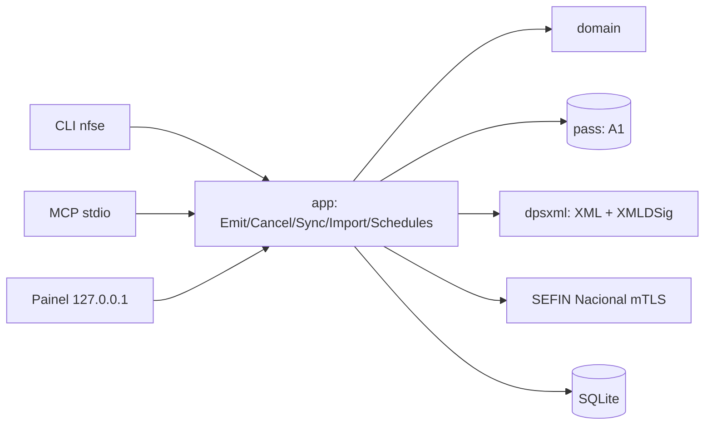
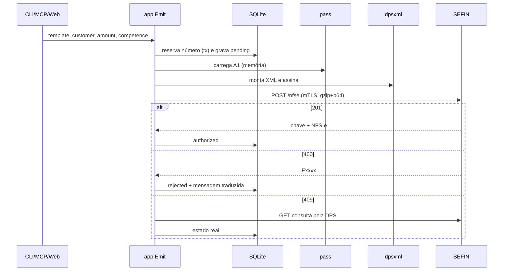

# Architecture — nfse-digital (binário `nfse`)

## 1. Introduction

Arquitetura do emissor descrito em `docs/prd.md`. Projeto greenfield, sem starter template: Go puro com a estrutura hexagonal da skill `go-hexagonal`.

### Change Log

| Date | Version | Description | Author |
|---|---|---|---|
| 2026-10-29 | 0.1 | Versão inicial | @architect |
| 2026-10-29 | 0.2 | Painel com visual shadcn renderizado no Go; Tailwind v4 standalone pelo Nix | @architect |

## 2. High Level Architecture

### Technical Summary

Um binário Go (`nfse`) com núcleo hexagonal: o domínio monta e valida a DPS; a aplicação orquestra emitir, cancelar, consultar e agendar; adapters de saída falam com o `pass` (certificado), a SEFIN Nacional (mTLS) e o SQLite; adapters de entrada são CLI, MCP (stdio) e HTTP local. Tudo roda na máquina do André; não há servidor remoto.

### Platform and Infrastructure

- Máquina local (macOS arm64). Ambiente por Nix (`flake.nix`, devShell com Go, Task, openssl, xmllint).
- Nenhum custo recorrente: sem nuvem, sem banco gerenciado.
- `nfse serve` roda o painel e o agendador; pode virar um LaunchAgent depois (fora do escopo inicial).

### Repository Structure

```
nfse-digital/
├── cmd/nfse/main.go              # wiring (isento de cobertura)
├── internal/
│   ├── domain/                   # DPS, Customer, Template, Invoice, Issuer, Schedule — puro
│   ├── ports/                    # interfaces: CertificateStore, Sefin, Repository, Clock
│   ├── app/                      # casos de uso: Emit, Cancel, Sync, ImportXML, RunSchedules
│   └── adapters/
│       ├── passcert/             # A1 vindo do pass
│       ├── sefin/                # cliente mTLS da API nacional
│       ├── dpsxml/               # serialização + XMLDSig + validação XSD
│       ├── sqlite/               # repositório
│       ├── cli/                  # comandos
│       ├── mcpserver/            # servidor MCP stdio
│       └── web/                  # painel html/template
├── schemas/                      # XSD oficiais versionados
├── testdata/                     # XML de exemplo, certificado de teste gerado
├── docs/
├── scripts/
├── Taskfile.yaml
└── flake.nix
```

### Diagram



### Architectural Patterns

- **Hexagonal (ports and adapters)**: domain não importa nada de fora da stdlib; adapters dependem de ports, nunca o contrário.
- **Idempotência por número de DPS**: o número é reservado e gravado como `pending` antes do envio; reenvio usa o mesmo número.
- **Outbox implícito**: toda ida à SEFIN grava XML enviado e recebido, com sucesso ou erro.

## 3. Tech Stack

| Category | Technology | Version | Purpose | Rationale |
|---|---|---|---|---|
| Linguagem | Go | 1.26 | tudo | binário estático, sem runtime (rule 19) |
| Banco | SQLite via `modernc.org/sqlite` | latest | persistência local | Go puro, sem CGO |
| PKCS#12 | `software.sslmate.com/src/go-pkcs12` | latest | abrir o A1 | suporta os algoritmos legados de .pfx da ICP-Brasil |
| XMLDSig | `github.com/russellhaering/goxmldsig` | latest | assinar DPS e evento | assinatura enveloped com C14N |
| XML | `github.com/beevik/etree` | latest | árvore para assinar | dependência do goxmldsig |
| Validação XSD | `xmllint` (libxml2) em teste | via Nix | conferir XML contra XSD | Go não tem validador XSD maduro; usado só em teste |
| MCP | `github.com/modelcontextprotocol/go-sdk` | latest | servidor MCP | SDK oficial |
| CLI | `github.com/spf13/cobra` | latest | comandos | padrão em Go |
| Web | `net/http` + `html/template` | stdlib | painel | sem JS próprio (NFR7) |
| CSS | Tailwind CSS standalone (`nixpkgs#tailwindcss_4`) | 4.3.3 | visual shadcn (tokens zinco, radius, cards) | binário único, sem Node; escolha do dono em 29/10/2026 entre Ant Design, Kumo, shadcn, Tabler e Mantine |
| Testes | `testing` + `httptest` | stdlib | unitário e adapter | servidor TLS fake da SEFIN |
| Tarefas | Task | 3.x | `task test:cov` etc. | padrão do dono |

## 4. Data Models

- **Issuer** — `CNPJ`, `LegalName`, `MunicipalRegistration`, `CityCode` (IBGE, 7 dígitos), `SimplesOption` (0 não optante, 1 MEI, 2 ME/EPP), `SimplesRegime`, `SpecialRegime`, `Environment` (`homologation`|`production`), `Series`, `NextNumber`.
- **Customer** — `ID`, `Document` (CNPJ ou CPF), `Name`, `Email`, `Address` (logradouro, número, bairro, IBGE, CEP).
- **Template** — `ID`, `Name`, `NationalTaxCode` (cTribNac, ex. `010701`), `MunicipalTaxCode`, `Description`, `ISSRate`, `DefaultCustomerID?`.
- **Invoice** — `ID`, `DPSNumber`, `Series`, `DPSId` (45 caracteres), `Environment`, `CustomerID`, `TemplateID`, `Amount` (centavos, `int64`), `CompetenceDate`, `Status` (`pending`|`authorized`|`rejected`|`cancelled`), `AccessKey?` (50 dígitos), `NFSeNumber?`, `ErrorCode?`, `ErrorMessage?`, `SentXML`, `ResponseBody`, `CreatedAt`, `UpdatedAt`.
- **Schedule** — `ID`, `TemplateID`, `CustomerID`, `Amount`, `DayOfMonth`, `Active`, `LastRunPeriod` (`YYYY-MM`).

Valor monetário sempre em centavos (`int64`); nunca `float64`.

## 5. API Specification (painel local)

Só `127.0.0.1:8735`. Todo POST exige token CSRF; toda requisição exige `Host` igual a `127.0.0.1:8735` ou `localhost:8735`.

| Método | Rota | Função |
|---|---|---|
| GET | `/` | lista de notas, filtros `?period=30d&status=` e KPIs |
| GET | `/invoices/{id}` | detalhe com retorno da SEFIN |
| POST | `/invoices` | emitir (produção exige campo `confirm_production=yes`) |
| POST | `/invoices/{id}/cancel` | cancelar |
| GET | `/invoices/{id}/danfse` | PDF |
| GET/POST | `/customers`, `/templates`, `/schedules`, `/settings` | cadastros |
| POST | `/import` | upload de XML de nota anterior |

MCP tools: `list_invoices`, `show_invoice`, `emit_invoice` (`confirm_production` obrigatório quando o ambiente é produção), `cancel_invoice`, `list_customers`, `list_templates`.

## 6. External APIs

### SEFIN Nacional — Sistema Nacional NFS-e

- **Purpose**: registrar a DPS e gerar a NFS-e, eventos (cancelamento), consulta.
- **Docs**: [manual de contribuintes, API v1.2 (out/2025)](https://www.gov.br/nfse/pt-br/biblioteca/documentacao-tecnica/documentacao-atual/manual-contribuintes-emissor-publico-api-sistema-nacional-nfs-e-v1-2-out2025.pdf/@@download/file)
- **Base URL**: homologação `https://sefin.producaorestrita.nfse.gov.br/SefinNacional`; produção `https://sefin.nfse.gov.br/SefinNacional`.
- **Auth**: mTLS com o e-CNPJ A1 do emitente.
- **Endpoints**:
  - `POST /nfse` — corpo `{"dpsXmlGZipB64": "<DPS assinada, gzip, base64>"}`; 201 devolve chave de acesso e NFS-e; 400 rejeição com lista de erros `Exxxx`; 409 DPS repetida.
  - `GET /nfse/{chaveAcesso}` — consulta.
  - `POST /nfse/{chaveAcesso}/eventos` — evento assinado (cancelamento e101101).
  - DANFSe — `GET /danfse/{chaveAcesso}`; host exato (SEFIN ou ADN) a confirmar na story 2.1.
- **Rate limits**: não documentados; uso pessoal fica em unidades por mês.
- ⚠️ **Swaggers divergentes** relatados pela comunidade; o que valer é o XSD oficial e a resposta real da homologação, registrados em `docs/sefin-notes.md` (story 2.1).
- ⚠️ **E0039 é esperado na homologação** para o emitente em Barueri (`3505708`). Em produção Barueri usa o emissor nacional (notas 37–39 de 05/10/2026, ver `docs/sefin-notes.md`).

### pass

- `bassi/nfse/cert-a1-pfx` — .pfx em base64 (importado em 29/10/2026 por `task cert:import`).
- `bassi/nfse/cert-a1-password` — senha do .pfx.
- Certificado: `CN=EXEMPLO TECNOLOGIA LTDA:11222333000181`, emissor `AC DIGITALSIGN RFB G3`, vence **02/12/2026 13:03 GMT**.

## 7. Core Workflows

### Emitir



### Agendamento

`nfse serve` verifica a cada minuto; um agendamento roda quando `day >= DayOfMonth` e `LastRunPeriod != período atual`. O período é gravado na mesma transação que reserva o número, então reiniciar o processo não emite duas vezes.

## 8. Database Schema

```sql
CREATE TABLE issuer (
  id INTEGER PRIMARY KEY CHECK (id = 1),
  cnpj TEXT NOT NULL, legal_name TEXT NOT NULL, municipal_registration TEXT,
  city_code TEXT NOT NULL, simples_option INTEGER NOT NULL, simples_regime INTEGER,
  special_regime INTEGER NOT NULL DEFAULT 0,
  environment TEXT NOT NULL DEFAULT 'homologation' CHECK (environment IN ('homologation','production')),
  series TEXT NOT NULL DEFAULT '1', next_number INTEGER NOT NULL DEFAULT 1
);
CREATE TABLE customers (
  id INTEGER PRIMARY KEY, document TEXT NOT NULL UNIQUE, name TEXT NOT NULL, email TEXT,
  street TEXT, number TEXT, district TEXT, city_code TEXT, zip TEXT
);
CREATE TABLE templates (
  id INTEGER PRIMARY KEY, name TEXT NOT NULL UNIQUE, national_tax_code TEXT NOT NULL,
  municipal_tax_code TEXT, description TEXT NOT NULL, iss_rate_bp INTEGER NOT NULL,
  default_customer_id INTEGER REFERENCES customers(id)
);
CREATE TABLE invoices (
  id INTEGER PRIMARY KEY, environment TEXT NOT NULL, series TEXT NOT NULL, dps_number INTEGER NOT NULL,
  dps_id TEXT NOT NULL, customer_id INTEGER NOT NULL REFERENCES customers(id),
  template_id INTEGER REFERENCES templates(id), amount_cents INTEGER NOT NULL,
  competence_date TEXT NOT NULL,
  status TEXT NOT NULL CHECK (status IN ('pending','authorized','rejected','cancelled')),
  access_key TEXT, nfse_number TEXT, error_code TEXT, error_message TEXT,
  sent_xml TEXT, response_body TEXT, created_at TEXT NOT NULL, updated_at TEXT NOT NULL,
  UNIQUE (environment, series, dps_number)
);
CREATE TABLE schedules (
  id INTEGER PRIMARY KEY, template_id INTEGER NOT NULL REFERENCES templates(id),
  customer_id INTEGER NOT NULL REFERENCES customers(id), amount_cents INTEGER NOT NULL,
  day_of_month INTEGER NOT NULL CHECK (day_of_month BETWEEN 1 AND 28),
  active INTEGER NOT NULL DEFAULT 1, last_run_period TEXT
);
```

`iss_rate_bp` em pontos-base (2,00% = 200). Dia do agendamento limitado a 28 para não cair em mês curto.

## 9. Backend Architecture

- `app` recebe ports por construtor; `cmd/nfse/main.go` só faz wiring.
- Adapter `sefin` recebe `*tls.Config` pronto (montado do A1) e `baseURL`; em teste aponta para `httptest.NewTLSServer`.
- Adapter `passcert` executa `pass show` por `exec.Command`, com o executável injetável para teste.
- Tradução de erros SEFIN numa tabela no domínio (`E0039` → mensagem fixa).

## 10. Frontend Architecture

`html/template` com layout único no visual do **shadcn admin** (escolhido pelo dono em 29/10/2026; comparação em `docs/reference/ui-options/index.html`): tokens de cor do shadcn em variáveis CSS (`--background`, `--foreground`, `--primary`, `--muted`, `--border`, `--radius`), barra lateral clara com emitente no topo, cards de borda leve, abas em pílula, faixa de ambiente fixa. CSS gerado pelo Tailwind v4 standalone a partir de `internal/adapters/web/styles/input.css`, varrendo os templates; o arquivo gerado `static/app.css` é embutido por `go:embed` e regenerado por `task css` antes do build. Componentes interativos do shadcn (dialog, combobox, ⌘K) viram HTML e CSS: formulário GET/POST e páginas próprias. Sem JavaScript.

## 11. Deployment Architecture

Sem deploy remoto. `task build` gera `bin/nfse`; `task install` copia para `~/.local/bin`. CI fora do escopo (projeto pessoal, sem remote próprio).

## 12. Development Workflow

```bash
nix develop               # Go, Task, openssl, xmllint
task test                 # testes
task test:cov             # gate 90% linha e branch, domain 100%
task build
bin/nfse cert check       # lê o A1 do pass e mostra CNPJ e validade
bin/nfse emit --template suporte --customer 56789012000100 --amount 19000.00 --competence 2026-10
```

Variáveis: `NFSE_DB` (padrão `~/.local/share/nfse/nfse.db`), `NFSE_PASS_PREFIX` (padrão `bassi/nfse`).
